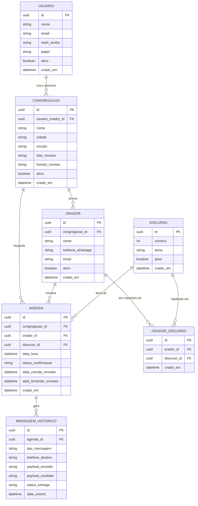

# Modelo de Dados Conceitual e Lógico — Agenda de Palestras

> Alinhamento com SPEC.md Seção 3.1, 3.2 e Fase 02.  
> As definições físicas de banco (PostgreSQL vs SQL Server) serão consolidadas na Fase 02.

---

## 1. Diagrama Entidade-Relacionamento Conceitual

---

## 2. Invariantes de Banco de Dados

1. **Índice Único de Agenda:** Constraint única impedindo que o mesmo orador possua dois agendamentos no mesmo horário/dia.
2. **Número de Discurso Único:** Constraint única para o número do discurso.
3. **Telefone Padronizado:** Formato internacional E.164 (ex: `+5511999998888`) para compatibilidade com APIs de WhatsApp.
4. **Deleção Restrita:** `DeleteBehavior.Restrict` em todas as relações para prevenir perda inadvertida de histórico de agendamentos.
5. **Repertório Único por Orador:** Constraint única composta em `(orador_id, discurso_id)` na tabela `ORADOR_DISCURSO` para impedir duplicações no repertório do mesmo orador.
6. **Consistência de Repertório na Agenda:** Ao registrar uma agenda, o discurso selecionado deve constar no repertório ativo do orador escolhido.
