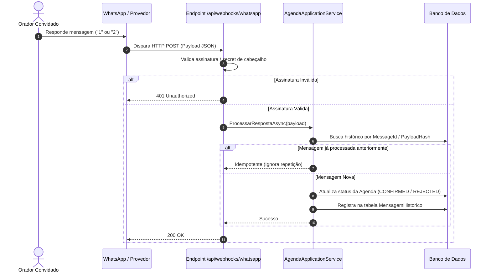

# Arquitetura de Integrações — Agenda de Palestras

> Alinhamento com SPEC.md Seção 3.1 e Fase 06.  
> Foco: Integração com WhatsApp, Webhooks e Resiliência.

---

## 1. Abstração do Provedor de WhatsApp

A comunicação com o WhatsApp é desacoplada através da interface de aplicação:

```csharp
public interface IWhatsAppNotificationService
{
    Task<MessageResult> EnviarConviteAsync(AgendaConviteDto convite, CancellationToken cancellationToken);
    Task<MessageResult> EnviarLembreteAsync(AgendaLembreteDto lembrete, CancellationToken cancellationToken);
}
```

Essa abstração permite suportar tanto a **Evolution API** (instância self-hosted) quanto a **WhatsApp Cloud API** (oficial da Meta) sem alterar o domínio.

---

## 2. Fluxo de Webhook e Idempotência



---

## 3. Diretrizes de Resiliência
- **Timeout e Retries:** Utilização de Polly para tentativas controladas em caso de falhas transitórias de rede (status HTTP 5xx / timeout).
- **Sem Segredos Expostos:** Chaves de API e tokens de webhook sempre lidos a partir de variáveis de ambiente.
- **Fail-Safe:** Falhas no provedor de mensagens não devem corromper a transação de agendamento principal no banco de dados.
